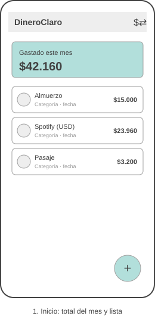
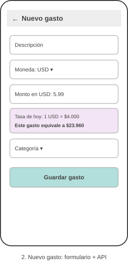
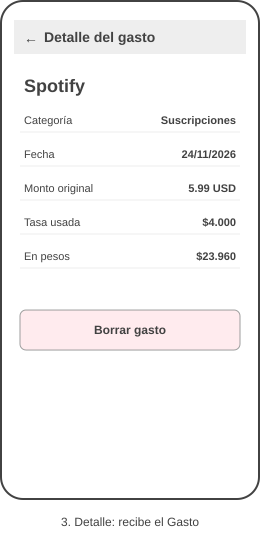
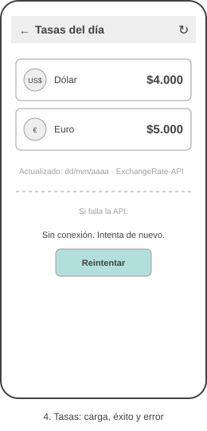
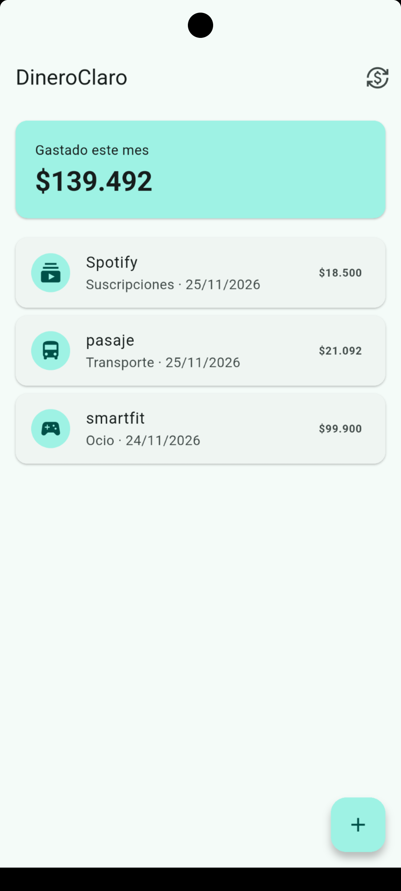
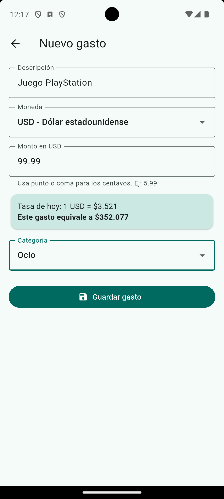
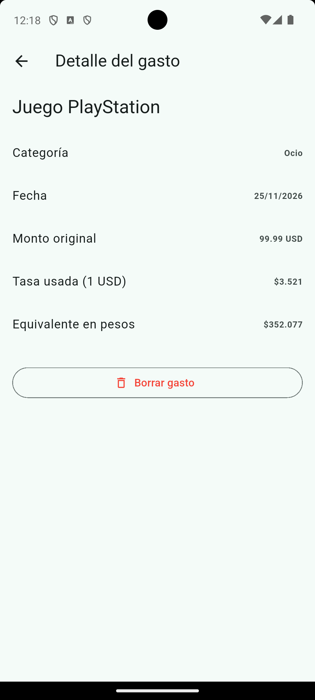
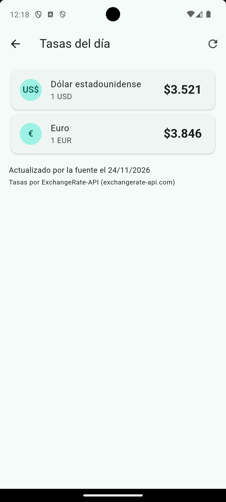
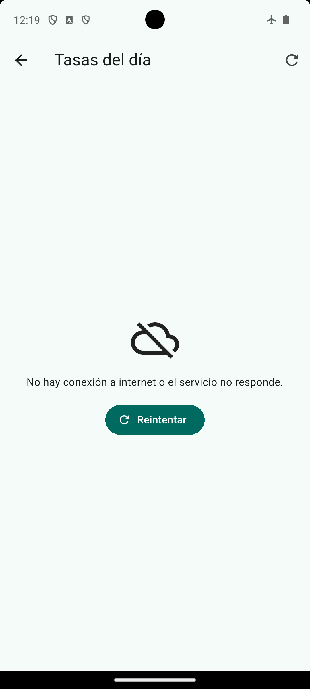
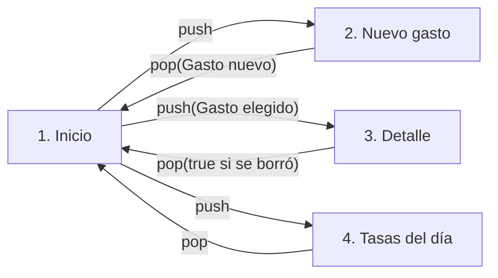

# DineroClaro 💸

Aplicación móvil en Flutter para que los estudiantes controlen sus gastos del mes, incluidos los que pagan en dólares o euros, y sepan cuánto les costaron en pesos colombianos.

Trabajo final de **Lenguajes de computación para móviles**.

---

## 1. El problema

Muchos estudiantes manejan un presupuesto mensual pequeño (la mesada, un trabajo de medio tiempo o un apoyo de sostenimiento) y a mitad de mes ya no saben en qué se les fue la plata. Además, cada vez pagan más cosas en moneda extranjera: suscripciones de música, diseño o juegos, cursos en línea y compras por internet. Como el dólar cambia todos los días, no saben cuánto les costó realmente ese pago en pesos.

Una aplicación móvil ayuda porque el celular es lo que el estudiante tiene a la mano justo después de pagar. Puede anotar el gasto en el momento, ver el total del mes y convertir automáticamente lo que pagó en otra moneda.

## 2. Usuarios

Estudiantes de colegio, universidad o formación técnica que manejan su propio dinero. Usarían la app:

- Justo después de pagar algo (almuerzo, pasaje, una suscripción).
- Antes de comprar algo en dólares, para saber cuánto les va a costar en pesos.
- A mitad o final de mes, para revisar cuánto llevan gastado.

## 3. Alcance

**Qué hace**

- Registra gastos en pesos (COP), dólares (USD) o euros (EUR), con descripción, categoría y fecha.
- Convierte a pesos los gastos en otra moneda usando la tasa del día, que consulta en una API.
- Muestra el total gastado en el mes y la lista de gastos.
- Muestra el detalle de cada gasto y permite borrarlo.
- Muestra cuántos pesos valen hoy 1 dólar y 1 euro.
- Guarda todo en el celular: los datos siguen ahí al cerrar y volver a abrir la app.

**Qué no hace**

- No tiene cuentas de usuario ni sincroniza en la nube.
- No se conecta con bancos ni billeteras digitales.
- No tiene gráficas ni presupuestos por categoría.
- No edita un gasto ya guardado (se borra y se crea de nuevo).

## 4. Diseño

Bocetos de las pantallas, hechos antes de programar:

| 1. Inicio | 2. Nuevo gasto | 3. Detalle | 4. Tasas del día |
|---|---|---|---|
|  |  |  |  |

Decisiones detrás de cada pantalla:

- **Inicio:** lo primero que ve el estudiante es cuánto lleva gastado este mes, porque esa es la pregunta principal. El botón **+** queda abajo a la derecha, donde llega el pulgar.
- **Nuevo gasto:** al elegir USD o EUR aparece al instante cuánto vale en pesos, para que el usuario lo vea antes de guardar. Los campos se validan para no guardar datos incompletos.
- **Detalle:** muestra la tasa con la que se convirtió el gasto, para que el usuario entienda de dónde sale el valor en pesos.
- **Tasas del día:** permite consultar el dólar y el euro sin registrar un gasto. Si no hay internet, lo dice claramente y deja reintentar.

## 5. La aplicación funcionando

| Inicio | Nuevo gasto | Detalle | Tasas del día | Error de la API |
|---|---|---|---|---|
|  |  |  |  |  |

## 6. Flujo entre pantallas



- **Inicio → Nuevo gasto:** el botón **+** abre el formulario con `Navigator.push`. Al guardar, el formulario regresa con `Navigator.pop(context, gasto)` y entrega el `Gasto` nuevo a Inicio, que lo guarda en SQLite.
- **Inicio → Detalle:** al tocar un gasto de la lista, el objeto `Gasto` **viaja** a la pantalla de detalle por su constructor: `DetalleGastoScreen(gasto: gasto)`. Si el usuario lo borra, Detalle regresa con `pop(context, true)`.
- **Inicio → Tasas del día:** el ícono de la barra superior abre la pantalla de tasas. Se regresa con la flecha atrás.

Se usa `MaterialPageRoute` con `push` y `pop`, como se vio en clase.

## 7. Cómo funciona, paso a paso


1. Al abrir la app, **Inicio** lee los gastos guardados en SQLite. Mientras lee, muestra un indicador de carga.
2. El usuario toca **+** y llena el formulario. Si elige **USD** o **EUR**, la app consulta la tasa del día en la API y muestra el equivalente en pesos.
3. Al tocar **Guardar**, el formulario valida los campos. Si todo está bien, devuelve el gasto a Inicio, que lo guarda en SQLite y actualiza el total del mes.
4. Al tocar un gasto, se abre su **detalle**, con el monto original, la tasa usada y el valor en pesos. Desde ahí se puede borrar.
5. En **Tasas del día** se ve cuántos pesos vale hoy 1 dólar y 1 euro. Si no hay conexión, aparece el error con el botón **Reintentar**.
6. Al cerrar la app y abrirla de nuevo, los gastos siguen ahí.

## 8. Modelo de datos y persistencia

### Modelo `Gasto` (`lib/models/gasto.dart`)

| Campo | Tipo en Dart | Columna en SQLite | Descripción |
|---|---|---|---|
| `id` | `int?` | `id INTEGER PRIMARY KEY AUTOINCREMENT` | Lo asigna SQLite al guardar |
| `descripcion` | `String` | `descripcion TEXT` | En qué se gastó |
| `montoOriginal` | `double` | `monto_original REAL` | Monto en la moneda en que se pagó |
| `moneda` | `String` | `moneda TEXT` | `COP`, `USD` o `EUR` |
| `tasa` | `double` | `tasa REAL` | Pesos por 1 unidad de la moneda (1 si es COP) |
| `categoria` | `String` | `categoria TEXT` | Comida, Transporte, Estudio, etc. |
| `fecha` | `DateTime` | `fecha TEXT` | Se guarda como texto ISO 8601 |

El valor en pesos no se guarda: se calcula con `montoCop = montoOriginal × tasa`.

**Decisión:** se guarda la **tasa del día en que se registró el gasto**. Así, si el dólar sube después, lo que el estudiante pagó ese día no cambia.

### Qué se guarda en el dispositivo y qué llega de la API

- **En el dispositivo (SQLite):** los gastos del usuario.
- **De la API:** las tasas de cambio del día. Solo se guarda en memoria durante una hora (caché), porque la API se actualiza una vez al día.

### Mecanismo elegido: SQLite con `sqflite`

El código está en `lib/services/base_datos.dart`. La base es un archivo `dinero_claro.db` dentro del celular, con una tabla `gastos`.

**¿Por qué SQLite y no un archivo JSON?**

| | SQLite (elegido) | Archivo JSON |
|---|---|---|
| Visto en clase | Sí | No |
| Borrar un gasto | `DELETE ... WHERE id = ?`, solo esa fila | Reescribir todo el archivo |
| Ordenar o filtrar | Con SQL (`ORDER BY fecha DESC`) | Hay que leerlo todo y hacerlo en Dart |
| Muchos gastos | Escala bien | Cada cambio es más lento |
| Plataformas | Android e iOS (no web ni Windows sin configuración extra) | Todas |

La desventaja de SQLite es que no funciona en el navegador ni en Windows sin configuración adicional. Por eso la app se prueba y se presenta en un emulador Android.

## 9. API usada

- **Nombre:** ExchangeRate-API (punto de acceso abierto)
- **Sitio:** https://www.exchangerate-api.com
- **Endpoint que se consulta:** `GET https://open.er-api.com/v6/latest/COP`
- **Clave:** no necesita. Por eso no hay ninguna clave privada en el repositorio.
- **Condiciones:** se actualiza una vez al día, tiene límite de consultas y exige dar el crédito, que aparece en la pantalla de Tasas.

Se pide con base **COP** para que una sola consulta traiga el dólar y el euro. La API responde cuánto vale 1 peso en cada moneda (por ejemplo, 1 COP = 0.00025 USD), y la app lo invierte: 1 / 0.00025 = 4.000 pesos por dólar.

**Ejemplo de respuesta** (resumida, los valores cambian cada día):

```json
{
  "result": "success",
  "provider": "https://www.exchangerate-api.com",
  "time_last_update_unix": 1795564800,
  "time_last_update_utc": "Wed, 25 Nov 2026 00:00:01 +0000",
  "base_code": "COP",
  "rates": {
    "COP": 1,
    "EUR": 0.000218,
    "USD": 0.000253
  }
}
```

**Cómo se usa en el código**

- `lib/services/api_tasas.dart` hace la petición con `http`, con **tiempo de espera de 10 segundos**.
- `lib/models/tasas_cambio.dart` convierte el JSON en el modelo `TasasCambio` (`fromJson`).
- Cualquier falla (sin internet, error del servidor, tiempo agotado, respuesta inválida) se convierte en un `ErrorApi` con un mensaje para el usuario.
- Las pantallas **Nuevo gasto** y **Tasas del día** manejan tres estados: **cargando**, **éxito** y **error con botón Reintentar**.

## 10. Estructura del proyecto

```
lib/
├── main.dart                     # Punto de entrada y tema
├── models/
│   ├── gasto.dart                # Modelo Gasto + toMap/fromMap
│   └── tasas_cambio.dart         # Modelo de la respuesta de la API
├── screens/
│   ├── inicio_screen.dart        # 1. Total del mes y lista
│   ├── nuevo_gasto_screen.dart   # 2. Formulario con validación
│   ├── detalle_gasto_screen.dart # 3. Detalle y borrado
│   └── tasas_screen.dart         # 4. Tasas del día
├── services/
│   ├── base_datos.dart           # SQLite (sqflite)
│   └── api_tasas.dart            # Consumo de la API (http)
├── utils/
│   ├── constantes.dart           # Categorías, monedas e íconos
│   └── formato.dart              # Formato de pesos y fechas
└── widgets/
    └── tarjeta_gasto.dart        # Tarjeta reutilizable de la lista
test/
└── widget_test.dart              # Pruebas del modelo y de la API simulada
```

## 11. Dependencias

| Paquete | Para qué se usa |
|---|---|
| `material_ui` | Widgets de Material Design. Desde Flutter 3.47, Material pasó del SDK a este paquete oficial, y el import `package:flutter/material.dart` quedó en desuso. Los widgets son los mismos que se vieron en clase. |
| `sqflite` | Base de datos SQLite para guardar los gastos en el dispositivo. |
| `path` | Armar la ruta del archivo de la base de datos (`join`). |
| `http` | Consultar la API de tasas de cambio. |
| `flutter_test` (desarrollo) | Pruebas automáticas, incluido `MockClient` para simular la API sin internet. |
| `flutter_lints` (desarrollo) | Reglas de estilo que revisa `flutter analyze`. |

Las versiones exactas están en `pubspec.yaml`.

## 12. Cómo ejecutar la aplicación

**Requisitos:** Flutter 3.50 o superior, Android Studio con un emulador Android (o un celular Android con depuración USB) y NDK 28.2 instalado desde el SDK Manager.

```bash
git clone https://github.com/JuanG140/dinero_claro.git
cd dinero_claro
flutter pub get
flutter devices                  # ver el nombre del emulador
flutter run -d emulator-5554     # usar el nombre que aparezca
```

Verificar la calidad del código:

```bash
flutter analyze   # debe decir: No issues found!
flutter test      # debe decir: All tests passed!
```

> ⚠️ La app debe ejecutarse en **Android**. En Windows o en el navegador, SQLite no funciona sin configuración adicional y la app mostrará "No se pudieron cargar tus gastos".

## 13. Problemas reales que enfrenté y cómo los resolví

| Problema | Causa | Solución |
|---|---|---|
| `flutter analyze` mostraba avisos de que `package:flutter/material.dart` estaba en desuso | En Flutter 3.47+, Material se separó del SDK | Agregué `material_ui` y migré los imports con `dart fix --apply --code=migrate_design_widgets` |
| La app decía "No se pudieron cargar tus gastos" | Se estaba ejecutando en Windows, donde `sqflite` no funciona | Ejecutarla en el emulador Android con `flutter run -d <emulador>` |
| La compilación para Android fallaba con "NDK 28.2 not found" | Faltaba esa versión del NDK | Instalarla desde Android Studio → SDK Manager → SDK Tools |
| La primera API que había elegido (Frankfurter) no servía | Solo tiene las monedas del Banco Central Europeo y no incluye el peso colombiano | Cambiar a ExchangeRate-API, que sí incluye COP y no pide clave |

## 14. Integrantes

| Integrante | Aporte |
|---|---|
| Juan Pablo Guerra ([@JuanG140](https://github.com/JuanG140)) | Proyecto individual: definición del problema, diseño, implementación, pruebas y documentación. |

## 15. Fuentes y ayudas utilizadas

- **Material del curso:** navegación con `Navigator`, `StatefulWidget` y `setState`, formularios con validación, `async`/`await`, `http` y SQLite con `sqflite`.
- **Documentación oficial:** [Flutter](https://docs.flutter.dev), [sqflite](https://pub.dev/packages/sqflite), [http](https://pub.dev/packages/http), [material_ui](https://pub.dev/packages/material_ui) y [ExchangeRate-API](https://www.exchangerate-api.com/docs/free).
- **Asistente de IA:** usé **Claude** como apoyo para idear el proyecto por etapas, apoyó en código y resolver errores de instalación y compilación, y redactar esta documentación. Revisé, probé y entiendo el código, y cada etapa se registró en un commit después de probarla en el emulador.
- **Bocetos:** generados como imágenes SVG para este proyecto.

## 16. Limitaciones y posibles mejoras

**Limitaciones**

- Solo funciona en Android (por SQLite con `sqflite`).
- Los datos viven solo en el celular: si se desinstala la app, se pierden.
- La API se actualiza una vez al día, así que no es la tasa exacta del momento del pago.
- Sin internet no se pueden registrar gastos en USD o EUR (en COP sí).
- Solo maneja tres monedas.

**Posibles mejoras**

- Editar un gasto ya guardado.
- Definir un presupuesto mensual y avisar cuando se esté acabando.
- Gráficas de gastos por categoría.
- Guardar la última tasa conocida para usarla sin conexión.
- Exportar los gastos a CSV.
- Copia de seguridad en la nube.
- **Validación con usuarios:** probarla con 3 a 5 compañeros durante una semana y preguntarles qué les costó usar y qué les faltó.

**Privacidad:** la app no envía los gastos a ningún servidor. La única petición a internet es la consulta de tasas, que no incluye datos del usuario.
